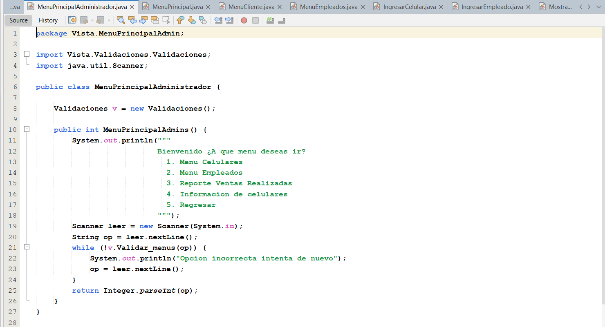
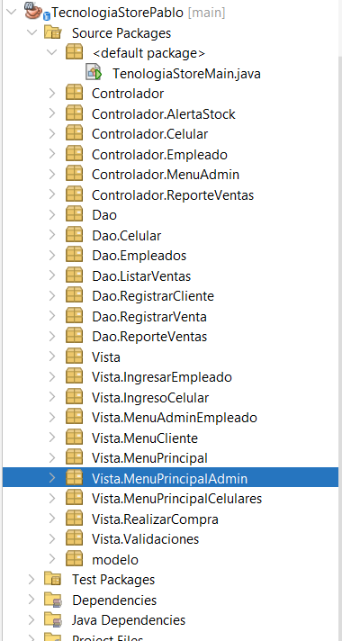
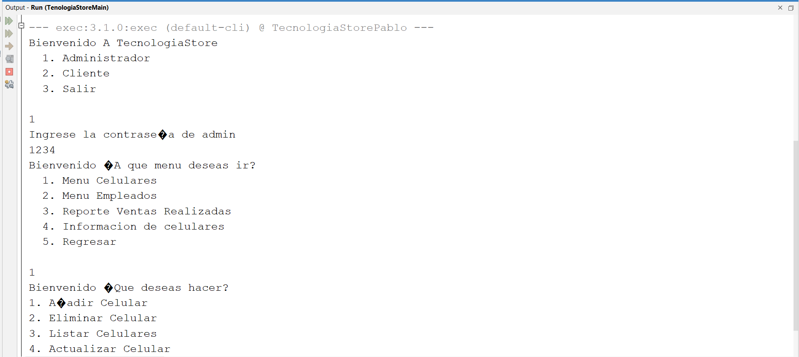

# TecnologiaStorePablo 📱💼

Una aplicación de consola robusta desarrollada en **Java** bajo la arquitectura **MVC (Modelo-Vista-Controlador)**, diseñada para la gestión integral de una tienda de tecnología especializada en telefonía móvil. El sistema integra persistencia transaccional en **MySQL** mediante **JDBC y Procedimientos Almacenados**, respaldo de datos en archivos binarios (`.dat`), manipulación avanzada de datos con **Java Stream API**, y la aplicación de **Patrones de Diseño**.

---

## 📋 Descripción del Proyecto

**TecnologiaStorePablo** automatiza las operaciones esenciales del negocio de manera eficiente:
* **Módulo de Ventas:** Permite registrar clientes, seleccionar empleados y procesar transacciones seguras de celulares con control de stock automatizado y transacciones complejas en la base de datos.
* **Persistencia y Respaldo Dual:** Cada venta procesada en MySQL se sincroniza automáticamente para generar un respaldo serializado en archivos binarios (`ventas.dat`).
* **Analítica con Java Stream API:** Procesamiento de reportes comerciales avanzados (filtrado por montos, cálculo de recaudo global, extracción de clientes únicos sin repetición).
* **Gestión de Inventario Inteligente:** Listado de dispositivos con control automatizado de stock mínimo aplicando el **Patrón de Diseño Strategy**.

---

## 📂 Estructura de Clases y Paquetes

La arquitectura del proyecto se encuentra organizada de la siguiente manera:

```text
TecnologiaStorePablo
 ├── Controlador
 │    ├── Controlador.Celular
 │    │    └── ControladorCelular.java          # Controla el inventario y validación de alertas
 │    └── ReporteVentasRealizadas.java          # Sincroniza BD con .dat y procesa analíticas con Streams
 ├── Estrategias
 │    ├── EstrategiaAlertaStock.java            # Interfaz del Patrón Strategy para alertas de stock
 │    └── AlertaStockMinimoStrategy.java        # Implementación de la alerta crítica de reabastecimiento
 ├── Dao
 │    ├── Dao.Celular
 │    │    ├── BuscarCelularDao.java
 │    │    └── ListarCelularDao.java
 │    ├── Dao.Cliente
 │    │    └── RegistrarClienteDao.java
 │    ├── Dao.Empleado
 │    │    ├── BuscarEmpleadoDao.java
 │    │    └── ListarEmpleadoDao.java
 │    ├── Dao.Venta
 │    │    ├── RegistrarVentaDao.java
 │    │    └── ListarVentas.java
 │    └── ListarVentas
 │         └── DatosVenta.java                  # Manejo de serialización y archivo binario (ventas.dat)
 ├── Vista
 │    ├── RealizarCompra
 │    │    └── RealizarCompra.java              # Interfaz de consola para la compra y validación de stock
 │    └── Validaciones
 │         └── Validaciones.java                # Filtros y validaciones robustas para entradas de consola
 └── modelo
      ├── Celular.java
      ├── Cliente.java
      ├── Empleado.java
      └── ReporteVenta.java
```

---

## ⚙️ Indicaciones para Conexión MySQL

Para que la aplicación se conecte correctamente con tu base de datos MySQL y ejecute los Procedimientos Almacenados:

1. **Creación de la Base de Días:** Ejecuta el script principal (`Script.sql`) en tu motor MySQL (por ejemplo, a través de Workbench o phpMyAdmin).
2. **Procedimientos Almacenados:** Asegúrate de cargar y compilar los procedimientos incluidos en el proyecto:
   - `ProceduresCelulares.sql`
   - `ProceduresEmpleado.sql`
   - `ProcedureClientes.sql`
   - `ProcedureReporteVenta.sql`
3. **Parámetros de Conexión:** En tu clase de conexión JDBC (dentro del paquete correspondiente de la capa DAO), verifica que los parámetros apunten a tu entorno local:
   - **URL:** `jdbc:mysql://localhost:3306/tu_base_de_datos?useSSL=false&serverTimezone=UTC`
   - **Usuario:** `root` (o tu usuario configurado)
   - **Contraseña:** Tu contraseña de MySQL

---

## 🚀 Ejemplo de Ejecución

Al iniciar la aplicación y seleccionar el módulo de **Realizar Compra** y posteriormente el **Reporte de Inventario con Alertas**, la consola mostrará flujos como el siguiente:

```text
=== MÓDULO DE COMPRAS ===
Registro de datos Cliente
Ingrese su nombre: Carlos Perez
Ingrese su cedula: 1098765432
Ingrese correo: carlos@email.com
Ingrese su numero de telefono: 3101234567

Celulares Disponibles
ID: ID-4B381 | Modelo: Sa23 | Precio: $1000000.0 | Stock: 2
ID: ID-EC531 | Modelo: P32  | Precio: $2500000.0 | Stock: 21
Ingrese el id del celular que deseas comprar: ID-4B381
Ingrese la cantidad a llevar: 1
El total de su compra fue 1000000.0

Empleados: 
ID EMP-01 NOMBRE: Ana Gomez
Ingrese el id del empleado que la atendio: EMP-01

========================================
¡COMPRA REALIZADA CON ÉXITO!
Código de Factura: VEN-A89F2
========================================

--- EVALUACIÓN DE INVENTARIO Y ALERTAS (Patrón Strategy) ---
========================================================
          INVENTARIO GENERAL DE CELULARES               
========================================================
ID: ID-4B381 | Modelo: Sa23 | Precio: $1000000.0 | Stock Actual: 1 | Stock Mínimo: 3

========================================================
        EVALUACIÓN DE ALERTAS DE STOCK MÍNIMO           
========================================================
  ⚠️ [ALERTA DE REABASTECIMIENTO]
  El celular Sa23 (ID: ID-4B381)
  tiene un stock crítico: 1 | Stock Mínimo Permitido: 3
  --------------------------------------------------
```

---

## 📸 Imagenes







---
*Desarrollado con arquitectura limpia, patrones de diseño y Java moderno.*